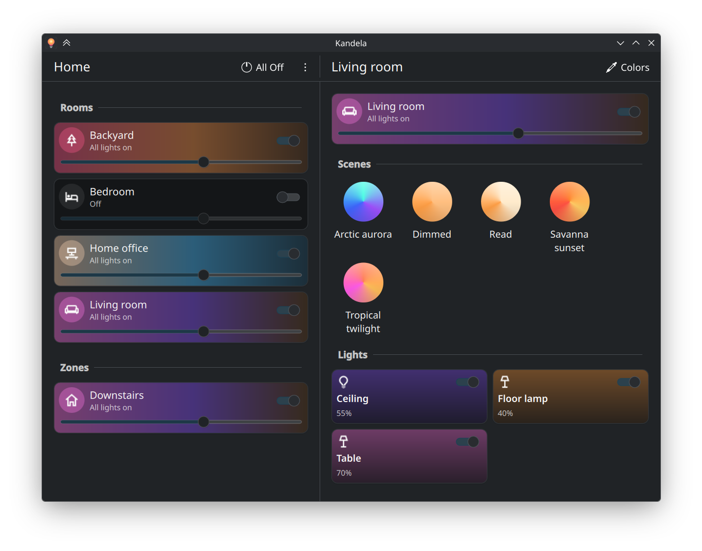
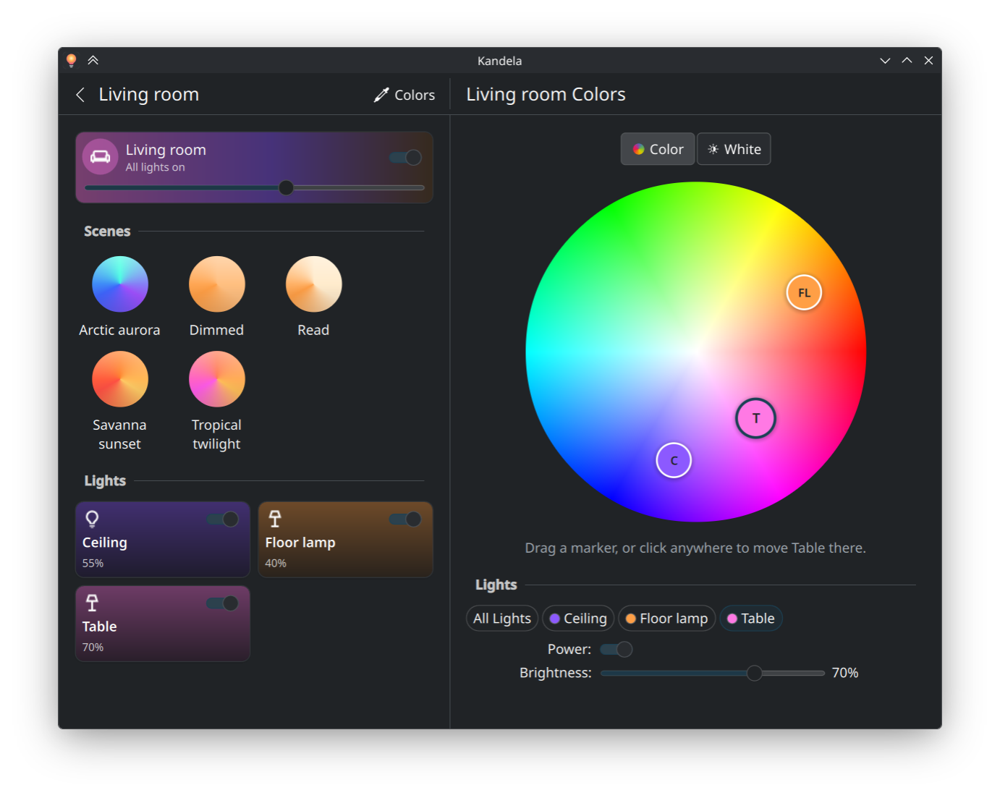

# Kandela

[](LICENSE)
[](https://kde.org/plasma-desktop/)
[](https://ko-fi.com/pcmciakai)

Kandela is a desktop app for Philips Hue lights, built for KDE Plasma (it also runs on other
desktops). It talks to your Hue Bridge directly over the local network, so no
Hue account or internet connection is needed.



- **Home:** every room and zone with an on/off switch and a brightness slider,
  tinted with the colors its lights are showing.
- **Room:** its scenes (click to recall) and each light.
- **Colors:** a color wheel and a warm-to-cool white bar with a marker per
  light. Drag a marker, or click to set one or all lights.
- Changes made in the phone app or with switches show up live (via the
  bridge's event stream).
- **System tray:** closing the window keeps the app running in the tray (can
  be turned off in the ⋮ menu). The bulb is lit while any light is on; click
  it to show or hide the window, right-click to switch rooms and zones, turn
  everything off, or quit. Ctrl+Q quits from the window.



## Build and run

Needs Rust, a C++ compiler and Qt 6 development files, plus Kirigami at
runtime. On Fedora / Nobara:

```sh
sudo dnf install qt6-qtbase-devel qt6-qtdeclarative-devel kf6-kirigami kf6-qqc2-desktop-style
```

```sh
cargo run --release -p kandela            # connect to your bridge
cargo run --release -p kandela -- --demo  # a made-up home, no bridge needed
cargo run --release -p kandela -- --hidden  # start in the tray
cargo run -p kandela-core --example discover  # list bridges on the network
cargo test --workspace
```

The first start lists the bridges it finds; pick yours and press the round
link button on the bridge. The key it receives is stored in
`~/.config/kandela/bridge.json`.

### Certificate pinning

The bridge's certificate is issued by Signify's private CA for the bridge id,
not its IP address, so it can't be checked the usual way. Instead the app
remembers the certificate the bridge presented while pairing and from then on
only talks to a device presenting that same certificate (`kandela-core/src/pinning.rs`).
If it ever changes, the app stops and asks you to pair again, so the key is
never sent to a device impersonating the bridge. A bridge that was factory
reset or replaced, or one whose certificate a firmware update reissued, needs
pairing again too.

Configs from before pinning existed get the certificate recorded on the next
start, after checking the bridge still reports the same bridge id.

To install for your user:

```sh
cargo install --path crates/kandela
install -Dm644 packaging/io.github.pcmciakai.kandela.desktop ~/.local/share/applications/io.github.pcmciakai.kandela.desktop
install -Dm644 packaging/io.github.pcmciakai.kandela.svg ~/.local/share/icons/hicolor/scalable/apps/io.github.pcmciakai.kandela.svg
```

To start it in the tray when you log in:

```sh
sed 's|^Exec=kandela$|Exec=kandela --hidden|' packaging/io.github.pcmciakai.kandela.desktop > ~/.config/autostart/io.github.pcmciakai.kandela.desktop
```

Starting the app while it's already running brings up the existing window.

## Flatpak

Kandela is packaged as a Flatpak on the KDE 6.11 runtime, which provides Qt,
Kirigami and the Breeze style, so the package itself is under 10 MB. Needs
`flatpak-builder` and the SDKs:

```sh
flatpak install --user flathub org.flatpak.Builder org.kde.Sdk//6.11 org.freedesktop.Sdk.Extension.rust-stable//25.08
```

Build into a local repository, then install from it with your system's
`flatpak`:

```sh
flatpak run --env=FLATPAK_USER_DIR=$HOME/.local/share/flatpak --command=flatpak-builder org.flatpak.Builder \
  --user --force-clean --repo=repo --state-dir=.flatpak-builder build-dir packaging/flatpak/io.github.pcmciakai.kandela.yml
flatpak --user remote-add --if-not-exists --no-gpg-verify kandela-local repo
flatpak --user install --reinstall kandela-local io.github.pcmciakai.kandela
```

Don't use `flatpak-builder --install` here: flatpak-builder runs in its own
sandbox, and the menu entry it installs would point at that sandbox's
`/app/bin/flatpak`, so the app wouldn't start from the application menu.

The sandbox only gets network access (for the bridge and mDNS), the display,
and D-Bus access to the system tray and notifications. Its settings live in
`~/.var/app/io.github.pcmciakai.kandela/`, so it is paired separately from a
native build.

Rust dependencies are vendored for the offline Flatpak build through
`packaging/flatpak/cargo-sources.json`. Regenerate it whenever `Cargo.lock`
changes:

```sh
python3 packaging/flatpak/gen_cargo_sources.py Cargo.lock packaging/flatpak/cargo-sources.json
```

To start the Flatpak in the tray when you log in:

```sh
sed 's|^Exec=kandela$|Exec=flatpak run io.github.pcmciakai.kandela --hidden|' packaging/io.github.pcmciakai.kandela.desktop > ~/.config/autostart/io.github.pcmciakai.kandela.desktop
```

## Layout

| Path | What it is |
| --- | --- |
| `crates/kandela-core` | UI-independent library: discovery (mDNS + Philips cloud fallback), pairing, the CLIP v2 API, the event stream, color math, the demo home, and `Service`, the background worker the UI talks to. |
| `crates/kandela` | The app: a small [CXX-Qt](https://github.com/KDAB/cxx-qt) bridge (`src/controller.rs`) and the Kirigami UI in `qml/`. |

`kandela-core` keeps the bridge's resources as raw JSON and merges event-stream
updates into them, then derives a flat snapshot (rooms, zones, lights, scenes)
that the UI renders. Commands are applied locally at once, so the UI feels
instant; slider drags are coalesced so the bridge only receives the latest
value roughly every 100 ms.

### Screenshots during development

```sh
KANDELA_SCREENSHOT=/tmp/shot.png KANDELA_ROUTE="colors:Living room" \
  QT_QPA_PLATFORM=offscreen cargo run -p kandela -- --demo
```

Routes: `home:`, `group:<name>`, `colors:<name>`, `white:<name>`.

Without `KANDELA_SCREENSHOT`, the route just opens that page in a normal
window, for taking screenshots of the real window with Spectacle's "Active
Window" mode (which is what Flathub asks for):

```sh
KANDELA_ROUTE="group:Living room" cargo run -p kandela -- --demo
```

## Known limitations

- No editing of scenes, rooms or automations yet; use the phone app for those.

## AI Disclosure

The majority of this project's source code was written with the help of AI
tools. Because the code is largely AI-generated, it builds on the collective
work of countless developers who share their knowledge openly — and it should
give back in the same way. For this reason, this project is and must always
remain open source.

## License

Kandela is free software: you can redistribute it and/or modify it under the
terms of the GNU General Public License as published by the Free Software
Foundation, either version 3 of the License, or (at your option) any later
version. See [LICENSE](LICENSE).

Philips and Hue are trademarks of Koninklijke Philips N.V. or Signify. Kandela
is an independent project and is not affiliated with or endorsed by them.
